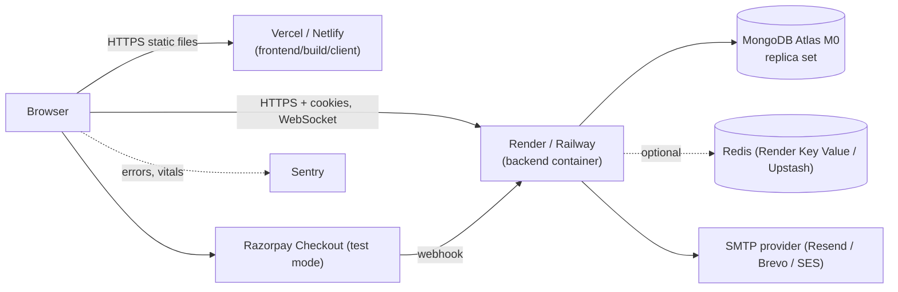

# Deploying ShopSphere

This is the recipe. **Nothing here was deployed for real**: there is no cloud account behind this repository, so every file below was validated locally (YAML/JSON parsed, `docker build` + `docker run` of both images, the same commands as CI run on a laptop) and the live steps (Atlas, Render, Vercel, DNS, Razorpay and Google dashboards, a phone on 4G) are an unchecked list for whoever owns the accounts. No secret is in git; every value you must supply is named `<LIKE_THIS>` below.



| Piece | Where | Config in this repo | Cost (checked against each provider's public pricing page when written; prices change: look again before relying on them) |
| --- | --- | --- | --- |
| Frontend (static) | Vercel Hobby or Netlify Starter | `frontend/vercel.json`, `frontend/netlify.toml`, `frontend/public/_headers` | free tier; Vercel Hobby is for non-commercial use |
| API | Render web service (Docker) or Railway | `render.yaml`, `backend/railway.json`, `backend/Dockerfile` | Render free sleeps after 15 min idle; "Starter" is a few USD per month. Railway bills usage (a trial credit, then pay as you go) |
| Database | MongoDB Atlas | none (clicks, below) | M0 is free (512 MB, shared, replica set so transactions work) |
| Redis | Render Key Value free tier, or Upstash | `render.yaml` | free tier is enough; optional with ONE API instance |
| E-mail | Resend / Brevo / SES | `SMTP_*` variables | free tiers cover a demo |
| Errors | Sentry free (Developer) plan | `VITE_SENTRY_DSN`, CI secrets | free quota; set a spend cap of 0 (Settings > Subscription) |
| Uptime | UptimeRobot / Better Stack free | none | free |

**Spending limits and alerts** (do these before sharing the URL): Render: set the workspace's "billing alerts"/budget; keep the service on the free or starter plan, no autoscaling. Railway: set a usage limit in Settings > Usage (it stops the project at the limit). Vercel/Netlify: Hobby/Starter tiers cannot exceed their limits into overage without upgrading. Atlas: M0 has no overage. Sentry: on-demand budget 0. Razorpay: test mode moves no money.

## 0. Before you start

- Domain strategy (decision in `frontend/docs/environments.md`): `shop.<DOMAIN>` for the frontend and `api.<DOMAIN>` for the API, so the refresh cookie is **same-site**. Without a custom domain use the proxy mode (section 4b); direct `*.vercel.app` to `*.onrender.com` does not work reliably (third-party cookies).
- Generate secrets locally, paste them into the host's dashboard, never into a file:
  `node -e "console.log(require('crypto').randomBytes(48).toString('hex'))"`

## 1. Database: MongoDB Atlas

1. Create a project and an **M0** cluster (pick the region nearest your API region).
2. Database Access > add a database user with a generated password, role `readWrite` on database `shopsphere` only (not "Atlas admin").
3. Network Access: Render/Railway have no fixed egress IPs on the free tier, so you either allow `0.0.0.0/0` (the user + password + TLS are then the only barrier: acceptable for a demo, not for real customer data) or use a paid plan with static IPs / private networking and allow only those. Write down which you chose.
4. Connect > Drivers > copy the SRV string and put the database name in the path:
   `mongodb+srv://<USER>:<PASSWORD>@<CLUSTER>.mongodb.net/shopsphere?retryWrites=true&w=majority`
   This is `MONGODB_URI`. (A URL-encode any special character in the password.)
5. Seed demo data **once**, from your laptop, never destructively:
   `cd backend && MONGODB_URI='<the Atlas string>' SEED_PASSWORD='<a strong demo password>' npm run seed`.
   `npm run seed` is a no-op when products already exist. `npm run db:reset` (which DROPS the database) refuses to run against a non-local URI unless you also pass `--i-know-this-wipes-the-database`; **do not use it on production**. The seeded accounts (`customer@`, `seller@`, `admin@shopsphere.dev`) get the password you pass in `SEED_PASSWORD`: the well-known development password is refused for a non-local database. Change or delete the admin account before inviting anyone.
6. Backups: M0 has **no** backups. Take a dump before risky changes: `mongodump --uri "<MONGODB_URI>" --out backup-$(date +%F)`; paid tiers add continuous backup. Restore: `mongorestore --uri "<MONGODB_URI>" --drop backup-DATE/` (to a fresh database first when rehearsing).

## 2. Backend: Render (or Railway)

**Render.** Dashboard > New > Blueprint > pick the repo (it reads `render.yaml`). Render asks for each `sync: false` value:

| Variable | Value |
| --- | --- |
| `MONGODB_URI` | from step 1 |
| `CORS_ORIGINS`, `CLIENT_URL` | `https://shop.<DOMAIN>` (exactly the browser origin: scheme + host, no trailing slash, no path) |
| `JWT_ACCESS_SECRET` | generated by the blueprint (`generateValue`) |
| `COOKIE_SECURE=true`, `COOKIE_SAMESITE=lax` | set by the blueprint (`none` only for the cross-site demo) |
| `RAZORPAY_KEY_ID/_SECRET`, `RAZORPAY_WEBHOOK_SECRET` | **test mode** keys (Razorpay dashboard, Test mode) |
| `GOOGLE_CLIENT_ID/_SECRET`, `GOOGLE_REDIRECT_URI` | optional (see section 5) |
| `SMTP_HOST`, `SMTP_PORT`, `SMTP_USER`, `SMTP_PASS`, `EMAIL_FROM` | your provider's SMTP credentials; the sender domain must be verified there |
| `REDIS_URL` | wired to the blueprint's Redis; delete the block and the variable for a single instance |

Then: Settings > Custom Domains > add `api.<DOMAIN>`, create the CNAME at your DNS host, wait for the certificate. Health check path is already `/api/v1/health`. The container refuses to boot with an invalid or unsafe production configuration (insecure cookie, dev secret, wildcard CORS): read its log if it exits immediately.

**Railway.** New Project > Deploy from GitHub > root directory `backend` (`backend/railway.json` selects the Dockerfile and the health check). Add the same variables under Variables; Railway injects `PORT`. Add Redis from the template if wanted; generate a domain or attach `api.<DOMAIN>`.

## 3. Frontend: Vercel (or Netlify)

`VITE_*` values are baked in when the build runs, so set them **before** the first deploy and redeploy after changing them.

**Vercel.** Import the repo, **Root Directory** `frontend` (`frontend/vercel.json` holds the build command, the output directory `build/client`, the SPA rewrite and the headers). Environment variables (Production): `VITE_API_URL=https://api.<DOMAIN>/api/v1`, `VITE_SITE_URL=https://shop.<DOMAIN>`, and optionally `VITE_SENTRY_DSN`, `VITE_ENVIRONMENT=production`, `SENTRY_AUTH_TOKEN`, `SENTRY_ORG`, `SENTRY_PROJECT` (the last three never reach the browser: they only let the build upload source maps). Add the domain `shop.<DOMAIN>`.
`vercel.json` is **generated** (Vercel reads it before the build, so it cannot be computed during it). The CSP inside it names the API origin and the hashes of React Router's inline scripts. Regenerate and commit it whenever the API origin or the inline scripts change:
`npm run build && VITE_API_URL=https://api.<DOMAIN>/api/v1 npm run headers:vercel`.
**Netlify.** Base directory `frontend` (`frontend/netlify.toml`); same variables. Headers are read from `build/client/_headers`, which the build writes, so there is nothing to regenerate.

### 4b. No custom domain (proxy mode)
Build with `VITE_API_URL=/api/v1`, and add this rewrite at the top of `vercel.json`'s `rewrites`:
`{ "source": "/api/:path*", "destination": "https://<API_HOST>/api/:path*" }`. The browser sees one origin (no CORS, first-party cookie). WebSockets are not proxied by Vercel: set the realtime URL to the API origin directly (it is authenticated by the access token, not the cookie), and add that origin to the CSP `connect-src`. Costs an extra hop per API call.

## 4. Docker (self-hosting both services)

```bash
docker compose --profile app up -d --build      # mongo + mailpit + API + storefront on http://localhost:5173
docker build -t shopsphere-frontend --build-arg VITE_API_URL=https://api.<DOMAIN>/api/v1 frontend
docker build -t shopsphere-backend backend
```
Run the two images behind any TLS terminator (Caddy, Traefik, a cloud load balancer). The frontend image is nginx only (about 50 MB, non-root, port 8080, `/healthz`); the API image is non-root, port from `PORT`, `HEALTHCHECK` on `/api/v1/health`.

## 5. Third parties that need the public URL

1. **Razorpay (test mode).** Dashboard > Settings > Webhooks > add `https://api.<DOMAIN>/api/v1/payments/webhook`, events `payment.captured`, `payment.failed`, `refund.processed`, secret = `RAZORPAY_WEBHOOK_SECRET`. A webhook is the PSP calling YOUR server over the public internet; it cannot reach `localhost`, which is why locally the mock gateway posts to itself. Webhooks are retried by Razorpay, and the handler is idempotent (B6).
2. **Google sign-in.** Google Cloud Console > OAuth client (Web): Authorised redirect URI `https://api.<DOMAIN>/api/v1/auth/google/callback`, authorised JavaScript origin `https://shop.<DOMAIN>`; put the id/secret and `GOOGLE_REDIRECT_URI` in the API's variables. Keep the consent screen in "Testing" with listed test users.
3. **E-mail.** Verify the sender domain (SPF + DKIM records at your DNS host) or messages land in spam.
4. **Sentry.** Create a "React" project; DSN to `VITE_SENTRY_DSN`; auth token (scope `project:releases` + `org:read`) to the host/CI secret store; see `frontend/docs/observability.md`.
5. **Uptime monitor.** Two HTTP(s) checks, 5 min: `https://api.<DOMAIN>/api/v1/health` (expects 200 and `"db":"up"`) and `https://shop.<DOMAIN>/` (expects 200). Alert by e-mail.

## 6. Post-deploy smoke checklist (run on desktop and on a phone over mobile data)

Unchecked until someone runs it against a real deployment.

- [ ] `https://shop.<DOMAIN>/` loads, no console errors, service worker registers (Application tab)
- [ ] Register a new account; the verification e-mail arrives; the link verifies it
- [ ] Log in; **refresh the page: still logged in** (this is the cookie test; if it fails see `frontend/docs/environments.md`)
- [ ] Search, filter, open a product, add to cart, apply a coupon (`SAVE10` from the seed)
- [ ] Place a COD order; see it in `/orders`
- [ ] Place an online order with the Razorpay **test** card; the order turns Paid (webhook received: check Razorpay's webhook log shows 200)
- [ ] Order tracking updates live (open the order, change its status as admin in another tab); the notification bell shows it
- [ ] Log out (and the other tab logs out); log in again
- [ ] Deep link refresh: `/p/<slug>`, `/orders`, `/account/profile`; an unknown URL shows the 404 page
- [ ] `curl -I https://shop.<DOMAIN>/` shows the CSP and `Cache-Control: no-cache`; `curl -I` of a hashed file shows `immutable`
- [ ] Throw a test error (section 6 of `frontend/docs/observability.md`): it appears in Sentry readable, with the release
- [ ] Uptime checks are green

## 7. Rollback (per service)

| Service | Bad deploy: how to go back | Time |
| --- | --- | --- |
| Frontend (Vercel) | Deployments > the last good one > "Promote to Production" (instant; no rebuild). Netlify: Deploys > "Publish deploy". Self-hosted: run the previous image tag (`docker run shopsphere-frontend:<previous-sha>`). Users with the new service worker get the old files again on the next update check; the `sw.js` is `no-cache` so it is picked up within a page load | seconds |
| Backend (Render) | Events/Deploys > pick the previous successful deploy > "Rollback". Railway: Deployments > the previous one > Redeploy. Self-hosted: previous image tag. **Rolling back code does not roll back data**: a schema change must stay compatible with the previous version for one release (expand, migrate, then contract) | minutes |
| Database | Restore a dump (section 1.6) into a NEW database, switch `MONGODB_URI`, verify, then retire the old one. Never restore over production blindly | tens of minutes |
| Secrets | Rotation steps are in `frontend/docs/runbook.md` | minutes |

Keep the deploy order: **API first, frontend second** when the API change is backwards compatible; the other way round when the frontend change removes the use of an old field. A breaking change needs a feature flag or an expand/contract release in between.

## 8. No secret in git history

Run before publishing the repository, and in CI (`gitleaks` action): `gitleaks detect --source . --log-opts="--all"`, or without the tool:
`git log -p --all | grep -nEi "(mongodb(\+srv)?://[^ ]*@|jwt_[a-z_]*secret=[^ ]{16}|sk_(live|test)_|rzp_(live|test)_[A-Za-z0-9]{10}|BEGIN [A-Z ]*PRIVATE KEY)"`.
The development values in `backend/.env.example` (`dev-only-...`) are placeholders and are refused by the API in production. If a real secret was ever committed: rotate it first (it is public the moment it was pushed), then clean history.
