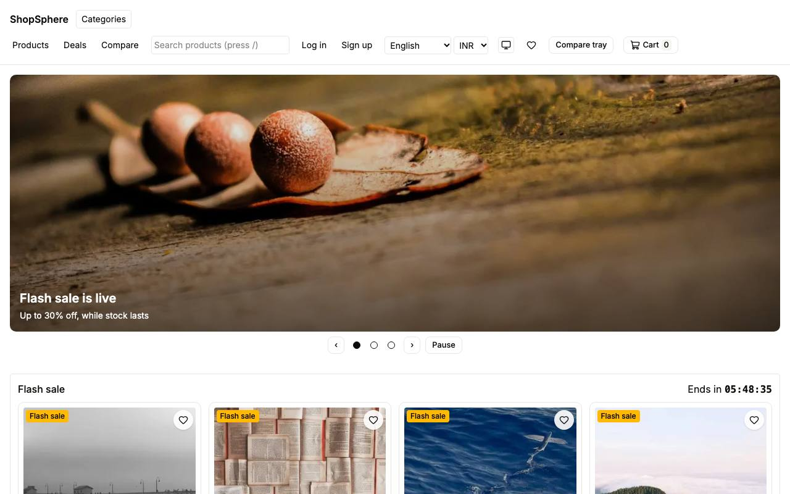
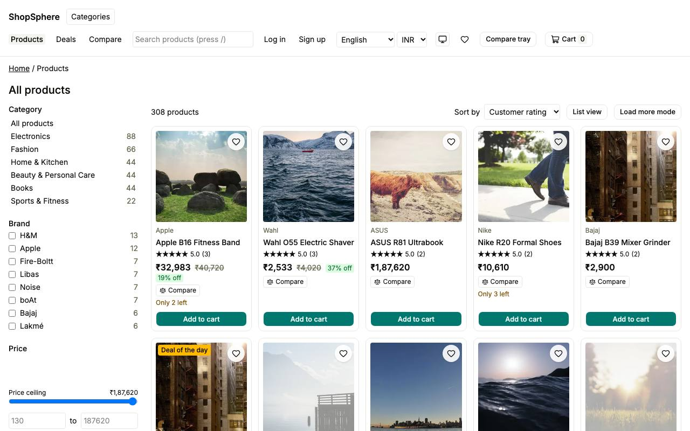
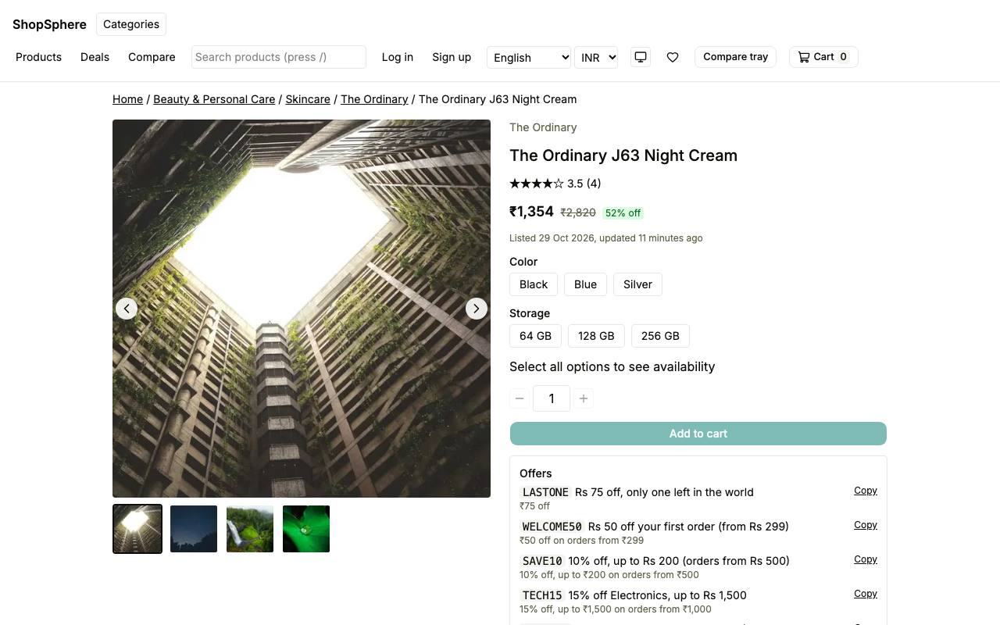
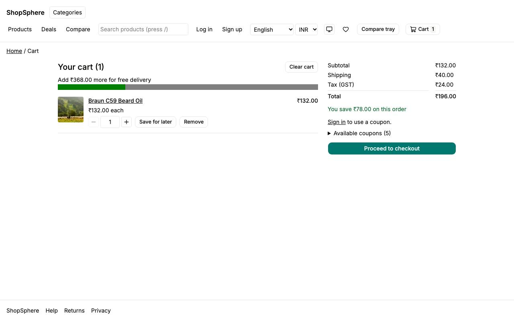
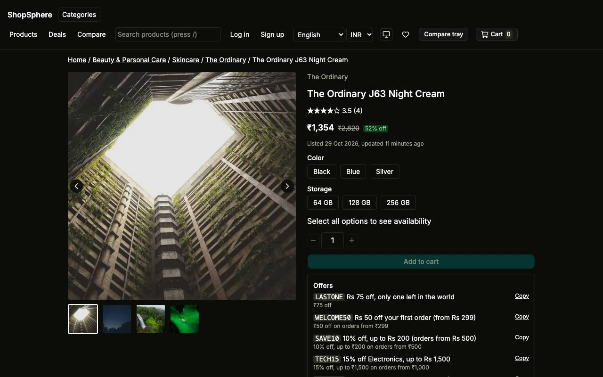
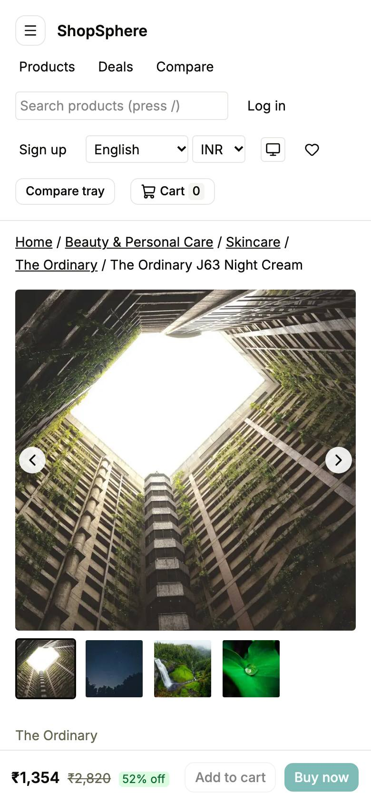
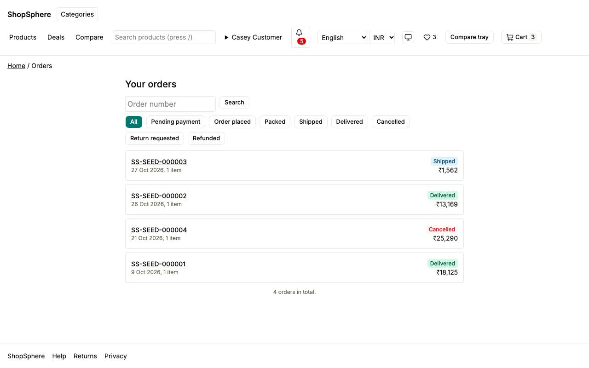
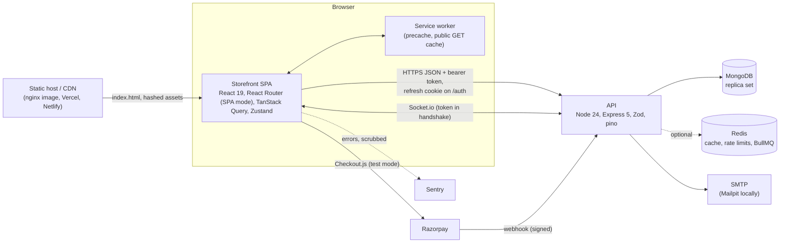

# ShopSphere

A production-style e-commerce platform (think Amazon / Flipkart) built to **learn React by implementation**.
Three independent projects in one repo — they deliberately share **no code or packages**.

| Folder | What | Stack | Who builds it | Port |
|---|---|---|---|---|
| [`frontend/`](frontend) | Customer storefront | React 19, React Router 8 (SPA mode), Tailwind 4, shadcn/ui | **You** (learning) | 5173 |
| [`admin/`](admin) | Admin / seller portal | TanStack Start + Router, shadcn/ui | **You** (learning, Admin track) | 3000 |
| [`backend/`](backend) | REST API | Node 24, Express 5, TypeScript, MongoDB (Mongoose), Zod | Claude (phased, API only) | 4000 |

Supporting services run in Docker ([`docker-compose.yml`](docker-compose.yml)): MongoDB (replica set), Mongo Express (DB browser), Mailpit (fake inbox), optional Redis.

## Status: storefront v1.0.0-storefront

The customer storefront and the API are complete through Stage 14 of the learning plan (catalog, search, cart, checkout with Razorpay test mode, accounts, orders with live tracking, reviews, notifications, dark mode, i18n, SEO, PWA; tests, CI, Docker, deployment configuration, error tracking). The admin portal (`admin/`) is the owner's own learning track and is a scaffold here. See [`CHANGELOG.md`](CHANGELOG.md) and [`frontend/docs/release-checklist.md`](frontend/docs/release-checklist.md).

| | | | |
|---|---|---|---|
|  |  |  |  |
| Home | Listing with filters | Product page | Cart |
|  |  |  | |
| Dark mode | Phone | Orders (signed in) | |

## Architecture



Key decisions are written down as ADRs in [`frontend/docs/adr/`](frontend/docs/adr): feature folders, SPA vs SSR, the fetch wrapper, TanStack Query, the Zustand scope, token storage, the Razorpay verification model, the static host and generated headers, error tracking.

## Run the whole stack in 15 minutes

Requirements: Node 24, Docker (for MongoDB and Mailpit), git.

```bash
git clone <this repo> && cd <this repo>
docker compose up -d                       # MongoDB (replica set) + Mailpit + Mongo Express

# terminal 1: the API
cd backend && cp .env.example .env && npm ci
npm run seed                               # ~300 products, a category tree, 3 dev users
npm run dev                                # http://localhost:4000/api/v1/health

# terminal 2: the storefront
cd frontend && echo 'VITE_API_URL=http://localhost:4000/api/v1' > .env.local && npm ci
npm run dev                                # development server on http://localhost:5173
# or exactly what users get:
npm run build && npm start                 # production build served like a static host
```

Sign in as `customer@shopsphere.dev` / `seller@shopsphere.dev` / `admin@shopsphere.dev`, password `Password123` (development seed only; the seed refuses to use it against a remote database). Verification and reset e-mails land in Mailpit at http://localhost:8025. Google sign-in and Razorpay run on built-in mocks until you supply credentials (`backend/.env.example`).

Everything in containers (API + storefront as images): `docker compose --profile app up -d --build`, then http://localhost:5173.

Quality gates: `cd frontend && npm run check` (format, lint, typecheck, unit/component tests, build, about 30 s) and `npm run e2e` (Playwright against the real stack, about 2 minutes); `cd backend && npm run lint && npm run typecheck && npm test`. Details in [`frontend/docs/testing.md`](frontend/docs/testing.md).

## Documentation map

| Topic | Where |
|---|---|
| Deploy (Atlas, Render/Railway, Vercel/Netlify, third parties, smoke checklist, rollback) | [`DEPLOY.md`](DEPLOY.md) |
| Operate (deploy, rollback, rotate secrets, incident playbooks) | [`frontend/docs/runbook.md`](frontend/docs/runbook.md) |
| Every environment variable, cookies and CORS across domains | [`frontend/docs/environments.md`](frontend/docs/environments.md) |
| Error tracking, source maps, uptime | [`frontend/docs/observability.md`](frontend/docs/observability.md) |
| Testing strategy and how to run it | [`frontend/docs/testing.md`](frontend/docs/testing.md) |
| Performance log and budgets | [`frontend/docs/perf-log.md`](frontend/docs/perf-log.md) |
| Security checklist, PWA rules, auth model, accessibility audit | [`frontend/docs/security.md`](frontend/docs/security.md), [`pwa.md`](frontend/docs/pwa.md), [`auth-token-model.md`](frontend/docs/auth-token-model.md), [`a11y-audit.md`](frontend/docs/a11y-audit.md) |
| SSR experiment | [`frontend/docs/ssr-experiment.md`](frontend/docs/ssr-experiment.md) |
| What was learned, per stage; the retrospective | [`frontend/docs/learning-notes.md`](frontend/docs/learning-notes.md), [`frontend/docs/retrospective.md`](frontend/docs/retrospective.md) |
| Contributing (branching, Definition of Done) | [`CONTRIBUTING.md`](CONTRIBUTING.md) |

## Known limitations

Stated plainly, so nobody has to find them:
- **Never deployed.** The deployment files and `DEPLOY.md` were not run against real Atlas/Render/Vercel accounts, and the post-deploy smoke checklist is unchecked. The Docker images were built and run locally (storefront 25 MB, non-root; API non-root; full compose stack and the e2e suite ran against it), but no image has been pushed to a registry or run on a real host.
- **Error tracking is verified against a fake Sentry ingest**, not a real project (source-map upload to Sentry's servers and the Sentry UI are unchecked).
- **CI has not run on GitHub** (no remote): the workflows were validated by parsing and by running the same commands locally.
- **Product pages are client-rendered.** Link previews of product URLs show a generic card and an unknown product answers HTTP 200 with a "not found" screen (a soft 404). An SSR variant exists as an experiment and is measured (`frontend/docs/ssr-experiment.md`).
- **Uploaded images are stored on local disk**; on a host with an ephemeral filesystem they vanish on deploy (the `ImageStorage` interface is ready for an object-store adapter).
- **Payments and Google sign-in run on mocks locally**; with real credentials only test mode was ever intended. The mock gateway is refused in production.
- **Translations** cover the header, cart, buy box and checkout only (Hindi written by the builder, not a translator); the Arabic locale is a pseudo language for the RTL layout.
- **Cross-site cookies**: login persistence needs the frontend and API on one registrable domain or a proxy; `*.vercel.app` + `*.onrender.com` is unsupported (`environments.md`).
- **Tests**: Chromium only; no visual regression or load tests; Razorpay Checkout and Google OAuth are not exercised for real.
- The product images are placeholders from picsum.photos; prices and stock are generated seed data.

## What I would do next
1. Deploy once for real (Atlas M0, Render, Vercel, a custom domain), tick the smoke checklist, and fix whatever it finds.
2. SSR (or edge-cached prerendering) for product and category pages only, with a CDN in front, if link previews or first-visit LCP matter (ADR 0002 has the checklist).
3. Move uploads to object storage and add a Sentry tunnel plus backend error tracking.
4. Visual regression and a small load test; run the e2e suite on WebKit and Firefox.
5. Build the admin portal on the same API and re-use the lessons about server functions and a BFF session.

## Start here

1. **Learning path →** [`learning-plan.md`](learning-plan.md) (stages, hands-on tasks, product spec, backend milestones)
2. **Backend mental models →** [`backend/docs/BACKEND-GUIDE.md`](backend/docs/BACKEND-GUIDE.md)
3. **API contract for your frontend →** [`backend/docs/API-CONVENTIONS.md`](backend/docs/API-CONVENTIONS.md)
4. **What Claude builds next →** [`backend/docs/BACKEND-ROADMAP.md`](backend/docs/BACKEND-ROADMAP.md)

## First-time setup

### 0. One repo, three folders
`frontend/` and `admin/` were scaffolded with their own `.git` folders. Fold them into one repo (this wipes their 1-commit histories):

```bash
cd /Users/abhishek/Documents/Projects/React
rm -rf frontend/.git admin/.git
git init && git add -A && git commit -m "chore: initial ShopSphere monorepo"
```

### 1. Infrastructure (Docker)
```bash
docker compose up -d          # mongo + mongo-express + mailpit
docker compose ps             # mongo should become "healthy" in ~10-20s
```
| Service | URL |
|---|---|
| MongoDB | `mongodb://localhost:27017/?replicaSet=rs0` |
| Mongo Express (browse data) | http://localhost:8081 |
| Mailpit (see emails the API sends) | http://localhost:8025 |

### 2. Backend
```bash
cd backend
cp .env.example .env          # already done once for you; edit if needed
npm install
npm run seed                  # ~300 products, category tree, 3 dev users
npm run dev                   # http://localhost:4000/api/v1/health
```
Interactive API docs: http://localhost:4000/api/docs
Dev logins (created by the seed — see `backend/src/seed/index.ts`): `customer@shopsphere.dev`, `seller@shopsphere.dev`, `admin@shopsphere.dev`.

### 3. Frontend / Admin
```bash
cd frontend && npm install && npm run dev     # http://localhost:5173
cd admin    && pnpm install && pnpm dev       # http://localhost:3000
```
> `frontend` runs in **SPA mode** (`ssr: false` in `frontend/react-router.config.ts`) and ships as static files. The SSR variant lives on its own branch with notes (`frontend/docs/ssr-experiment.md`).

## Daily commands

| Task | Command |
|---|---|
| Start/stop infra | `docker compose up -d` / `docker compose down` |
| Wipe all DB data | `docker compose down -v` then `up -d` and `npm run seed` |
| Reseed from scratch | `cd backend && npm run db:reset` |
| Backend tests / lint / typecheck | `npm test` / `npm run lint` / `npm run typecheck` |
| Add Redis (later phases) | `docker compose --profile cache up -d` |
| Run API + storefront in Docker (prod-like) | `docker compose --profile app up -d --build` |

## Ports cheat-sheet
`5173` storefront · `3000` admin · `4000` API · `27017` MongoDB · `8081` Mongo Express · `8025` Mailpit inbox · `1025` SMTP · `6379` Redis

## Troubleshooting
* **Mongo container restarts forever with "Linux kernel versions 6.19 and newer…"** — MongoDB 8.x refuses to run on very new Docker VM kernels ([SERVER-121912](https://jira.mongodb.org/browse/SERVER-121912)). That's why `docker-compose.yml` pins **`mongo:7.0`** (fully supports replica sets/transactions). Move to 8.x once MongoDB ships the fix.
* **`MongoServerSelectionError` from the API** — Mongo isn't healthy yet (`docker compose ps`), or `MONGODB_URI` in `backend/.env` is wrong.
* **CORS error in the browser** — your frontend origin isn't in `CORS_ORIGINS`, or the request lacks `credentials: "include"`.
