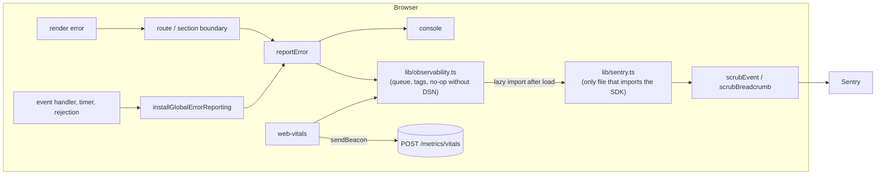

# Observability: error tracking, source maps, web vitals, uptime (14.6)

## What is wired

- **One funnel.** Components never import Sentry. They call `reportError(error, context, extra?)` (`lib/report.ts`): the console line is unchanged, and `lib/observability.ts` forwards to Sentry when it is enabled. Boundaries (`RouteErrorView`, `SectionBoundary` with the component stack), window `onerror` and `unhandledrejection` (`globalErrors.ts`) all end there. The SDK's own global-handler integration is switched off so nothing is sent twice.
- **Off means off.** `VITE_SENTRY_DSN` is read at build time. Without it `__SENTRY_ENABLED__` is the constant `false`, the dynamic `import("./sentry")` is dead code and the bundler drops it: **the build contains no Sentry code** (the 155 kB / 53 kB gzip SDK chunk exists only in builds with a DSN; checked by building both and listing `build/client/assets`; `e2e/production.spec.ts` asserts no Sentry request or chunk). Every function is a no-op. Tests: `lib/observability.test.ts`.
- **With a DSN.** The SDK loads after the page's `load` event (it never competes with LCP). Errors before it arrives are queued (25 max) and flushed in order. A blocked SDK (ad blocker, CSP) is caught and logged once; the shop keeps working.
- **What an event carries.** `release` (`VITE_RELEASE`, the git SHA), `environment` (`VITE_ENVIRONMENT` or the Vite mode), tag `context` (`route error boundary`, `boundary:<label>`, `window.onerror`, `unhandledrejection`), for API failures the tags `api_status`, `api_code` and **`request_id`**, the component stack for boundaries, breadcrumbs (clicks, navigation, fetch/xhr with query strings removed, console, and one `web-vital` breadcrumb per metric), and `user.id` only.
- **Web vitals.** Unchanged (13.1): one `sendBeacon` per metric to the API's `POST /metrics/vitals`. With Sentry enabled each metric is also a breadcrumb (so an error report shows the page's LCP/CLS so far) and a `trace_metric` distribution (`web_vital.lcp`, ...), which the fake-ingest run showed arriving.
- **Tracing is off** (`VITE_SENTRY_TRACES_SAMPLE_RATE` empty = 0): set `0.1` to sample 10% of page loads; the browser tracing integration is only added then.

## Privacy: what never leaves the browser

`SENTRY` options: `dataCollection` = no user info, cookies, headers, bodies or query strings; `scrubEvent` (`beforeSend`) and `scrubBreadcrumb` (`beforeBreadcrumb`) in `lib/scrub.ts` then remove e-mail addresses, JWTs and `Bearer ...` values from every string, drop the query string and fragment of every URL (a `/reset-password?token=...` link, a `?search=jane@x.com` API call), redact values under keys like `password`, `token`, `authorization`, `cookie`, `email`, `phone`, `card`, and reduce `user` to `{ id }`. Unit tests assert the output contains none of the planted values; `npm run verify:sentry` checks it again on a real production build in a real browser (below).

## Source maps (readable stack traces)

A minified stack (`index-9fK2.js:1:48211`) is useless without the map. The flow, all in `vite.config.ts`:

1. **Only when `SENTRY_AUTH_TOKEN` is set** (CI or the host's build environment; not `VITE_`-prefixed, so it can never reach the bundle) the build emits `sourcemap: "hidden"` (maps exist; the JavaScript carries no `//# sourceMappingURL`) and runs `@sentry/vite-plugin`, which uploads them to the release named `VITE_RELEASE`, then **deletes every `.map`** from `build/client` (even when the upload failed). Without a token: no maps, no upload, no network access.
2. The SDK's `release` is the same `VITE_RELEASE`, so Sentry pairs an event with its maps. Use the git SHA: CI sets `VITE_RELEASE=${{ github.sha }}`; Vercel exposes `VERCEL_GIT_COMMIT_SHA` (set `VITE_RELEASE=$VERCEL_GIT_COMMIT_SHA` in the build command or the env UI).
3. A failed upload **fails a CI build** (`errorHandler` rethrows when `CI` is set; locally it only warns): a release without maps is unreadable, better to find out before it ships.
4. Guards: `npm run check:bundle-secrets` fails when any `.map` is left in `build/client`; `e2e/production.spec.ts` asserts `/assets/<file>.js.map` is a 404 and no file has a `sourceMappingURL`.

Docker: `docker build --secret id=sentry_token,env=SENTRY_AUTH_TOKEN --build-arg SENTRY_ORG=... --build-arg SENTRY_PROJECT=... --build-arg VITE_SENTRY_DSN=... --build-arg VITE_RELEASE=$(git rev-parse HEAD) frontend` (the token is a BuildKit secret, not a build argument: arguments are visible in `docker history`).

## Verifying it without an account: `npm run verify:sentry`

Needs the backend on `:4000` and ports `5173`/`9999` free. It starts a **fake Sentry ingest** on `:9999`, builds the app with `VITE_SENTRY_DSN=http://key@localhost:9999/1`, a release name, an auth token and `SENTRY_URL` pointing at the fake (so the real upload code runs: it tried the release and chunk-upload endpoints and, as expected, got 404s, which only warn locally), serves that build, signs in as the seeded customer in Chromium and clicks the buttons of the lab page `/debug/sentry` (render error, event-handler error, unhandled rejection, failed API call, a PII probe). Then it parses the envelopes the fake received. Last run: **17 of 17 checks**: release and environment tags on every event; `user` is exactly `{ id }` and the id is the signed-in user's; the failed-API event's `request_id` tag equals the `x-request-id` header the server returned; breadcrumbs contain `ui.click`, `fetch`/`xhr`, `console`, `web-vital`; the PII probe arrives as `[email]`/`[token]`; the strings `customer@shopsphere.dev`, a JWT prefix, `token=SECRET123`, the dev password appear **nowhere** in any envelope; no URL in an envelope has a query string; and a minified frame from the production bundle (`debug-sentry-<hash>.js:1:724`) resolves through the produced source map to `app/routes/debug-sentry.tsx:15`. It then rebuilds the normal build.

**Not verified: a real Sentry project.** No account or DSN exists here. What that leaves open: that Sentry's own symbolication accepts the uploaded bundle (the plugin's upload protocol is the vendor's; I checked that the code ran and that the maps resolve with an independent source-map library), the Sentry UI view of an event, and quota behaviour. The first real deploy should repeat the smoke step "throw a test error" (`/debug/sentry` in a build that has a DSN) and look at the issue in Sentry: readable frames, the release tag, the breadcrumbs.

## From a frontend event to the backend log (request id)

Every API response carries `x-request-id` (backend `pino-http`, exposed to browsers by CORS). `ApiError` keeps it (`error.requestId`), `reportError` puts it in the tag `request_id`, and the error page shows it as "Reference". To follow an incident: open the Sentry event, copy `request_id`, then on the API host search the logs for it (`grep <id>` locally; Render > Logs > search; each request's log line, and any error logged while handling it, has `req.id`). Checked here: a `curl` to a 404 returned an id and that id was in the backend's log output.

## Uptime and backend monitoring

- Two HTTP checks every 5 minutes (UptimeRobot / Better Stack free plans): `GET https://api.<DOMAIN>/api/v1/health` (expect 200 and the body containing `"db":"up"`) and `GET https://shop.<DOMAIN>/` (expect 200). Alert by e-mail. The nginx image also answers `/healthz` for container orchestrators.
- Render keeps and searches the API's JSON logs (`LOG_LEVEL=info` in production). Backend Sentry is not added: the API logs structured errors with the request id, and the plan scopes error tracking to the frontend.
- Spending: Sentry free plan with on-demand budget 0.

## Limits and what to look at first when it breaks

- Ad blockers block `*.sentry.io`: undercounts errors for those users. A `tunnel` (an API endpoint that forwards envelopes) fixes it; not built.
- `ignoreErrors` hides `AbortError` and the ResizeObserver loop message; extend it only with a reason.
- Chunk-load errors after a deploy ("Failed to fetch dynamically imported module") are reported on purpose: a burst of them right after a release means the old `index.html` is being served for new asset hashes, or the CDN cache is stale.
